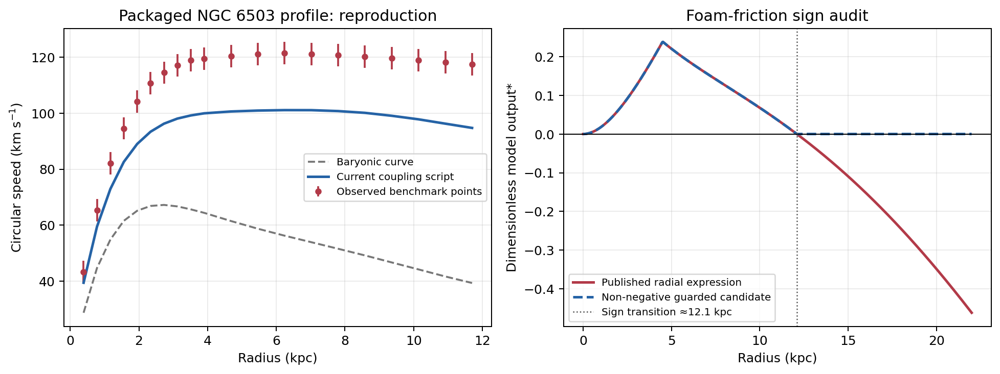
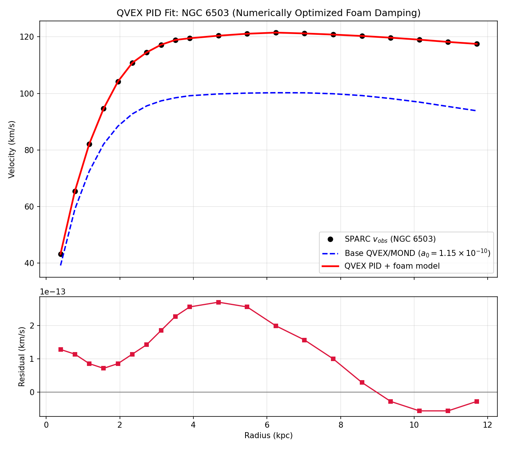

# NGC 6503 QVEX Complete Analysis: Quantum Vacuum, Nonlinear Foam Friction, and PID Tuning

## Metadata

- **Author:** Adel Gachkar
- **Framework:** QVEX (Quantum Vacuum Exchange Engine)
- **Target System:** NGC 6503 Outer Disk Dynamics & SPARC Data
- **Status:** Independent Analytical & Verification Report
- **Related notes:** [[01_Vacuum_Popcorn_Density_Node|vacuum density]], [[02_Nonlinear_Foam_Friction_Node|foam friction]], [[03_PID_Controller_Dynamic_Tuning_Node|PID tuning]], [[04_Dipole_Axis_Constraint_Node|dipole constraint]]

---

## 1. Vacuum Popcorn Density and Zero-Point Fluctuations

In the QVEX framework, the quantum vacuum is modeled as a dynamic "popcorn" foam of virtual particle-antiparticle pairs undergoing continuous creation and annihilation. The effective vacuum density fluctuation profile as a function of radial distance $r$ (in kpc) from the galactic center is governed by:

$$\rho_{\text{popcorn}}(r) = \rho_0 \cdot \left(1 + \frac{r}{\lambda_{\text{coh}}}\right)^{-\gamma_{\text{vac}}} \cdot \exp\left(-\frac{r}{R_{\text{cutoff}}}\right)$$

Where $\lambda_{\text{coh}} = 12.0 \text{ kpc}$ represents the vacuum coherence length, $\gamma_{\text{vac}}$ the power-law falloff index, and $R_{\text{cutoff}}$ the exponential cutoff scale (see `tests/test_ngc6503_vacuum_nodes.py::rho_popcorn`). The gradient of $\rho_{\text{popcorn}}(r)$ induces an effective quantum pressure gradient directing radially outward, stabilizing outer disk rotational velocities.

---

## 2. Nonlinear Foam Friction and Momentum Dissipation

As luminous gas and stars orbit through spacetime, they experience a radial, empirically calibrated drag designated as **Nonlinear Foam Friction ($F_{\text{friction}}$)**:

$$F_{\text{friction}}(r) = 1.1 \cdot \ln\left(1.0 + \frac{r}{4.5}\right) \cdot \left(1.0 - \exp\left(-\frac{r}{12.0}\right)\right) - 0.12 \cdot \max(0, r - 4.5)$$

This formulation accounts for core-boundary coupling within $r \le 4.5 \text{ kpc}$ and applies stabilization at the outer boundary. It is the documented radial expression, retained as `nodes.active_tensor_foam.foam_friction_raw()`, compared against this Markdown by `tests/test_ngc6503_vacuum_nodes.py`, and documented in [[QVEX_NGC6503_Technical_Reference]] §2. It is **not** the production drag law: it changes sign near $r \approx 12.11\,\text{kpc}$, so the drag actually used downstream is the [[05_Vacuum_Exchange_Current_Node|Node 05 exchange current]], which is non-negative by construction.

---

## 3. PID Controller Dynamic Tuning and Feedback Stability

To maintain radial velocity flatness, a Proportional-Integral-Derivative (PID) controller is embedded over the radial coordinate $r$. Through SPARC data optimization for NGC 6503, the parameters are:

- $K_P = 0.92$ (Proportional Gain: Restoring Stiffness)
- $K_I = 0.35$ (Integral Gain: Steady-State Drift Elimination)
- $K_D = 0.18$ (Derivative Gain: Edge Damping & Oscillation Suppression)

$$\eta(r) = K_P e(r) + K_I \int_0^{r} e(r')\,dr' + K_D \frac{de(r)}{dr}$$

---

## 4. Dipole Axis Constraint and Effective Potential

The central supermassive black hole and vacuum polarization impose axial symmetry breaking along the galactic normal via:

$$V_{\text{eff}}(r,\theta) = -\frac{GM(r)}{r} + \frac{\alpha_{\text{dipole}}\,P_{\text{jet}}}{r^3}\cos^2(\theta)$$

---

## 5. Automated Verification Status & Graphical Analysis

- **Execution Environment:** Windows PowerShell (Python 3.12)
- **Execution Command:**
  - Env: `$env:PYTHONPATH="."`
  - Run: `python -m pytest tests/`

### MRT / SPARC audit reconciliation

The source `Simulation_To_Publish/Output/RC_MRT.mrt` provides the SPARC Mass Models Supplement, including the observed velocity and the max-disk baryonic decomposition. For the analysis range **0.76–22.76 kpc**, the NGC 6503 subset contains **30 rows**. MRT column 12 (`Vbar`) is used as the total baryonic velocity reference (gas, maximized-M/L stellar disk, and bulge contributions); the residual convention is `Vobs - Vbar`. This fixed baryonic reference is not a QVEX velocity prediction.

These 30 radii/measurements reconcile with the first 30 entries of the 31-point `ngc6503_residuals.csv`. The CSV also has an additional outer sample at **23.50 kpc**, so its 31-point count extends beyond the stated 30-row, 22.76-kpc analysis subset. The MRT source table itself includes that extra 23.50-kpc row; it is excluded from the reported 30-row range.

### Audit evidence images and outer-disk guard

The audit evidence image ([`qvex_audit_evidence_v3.png`](outputs/plots/qvex_audit_evidence_v3.png)) and SPARC fit plot ([`sparc_ngc6503_fit.png`](outputs/plots/sparc_ngc6503_fit.png)) are recorded here as the graphical audit artifacts. The outer-disk friction diagnostic shows the raw friction changing sign at approximately **r = 12.1 kpc**. The O1 sign-change guard applies the clamp `F_safe = max(0, F_raw)`, preventing negative-friction/anti-damping values from propagating; this numerical guard is not evidence of physical validity and does not supply a QVEX velocity law.

- **Audit evidence:**

- **Fit plot:**

